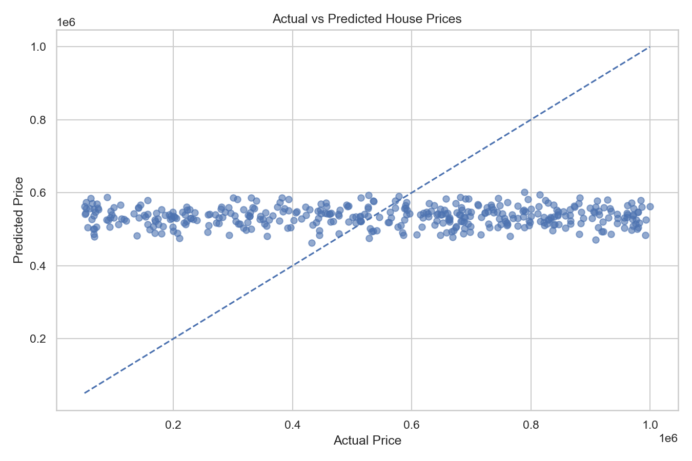

# 🏠 House Price Prediction: End-to-End ML Project

   

> A reproducible regression pipeline that goes from raw CSV to a deployed-style Streamlit app: cleaning, EDA, statistical testing, 5-model comparison, tuning, SHAP explainability, and a saved model for inference.

**🔗 Live demo:** _add Streamlit Cloud link_  |  **📓 Code:** `house_price_ml.py`, `app.py`

---

## 📊 Results at a Glance

| Metric | Value |
|---|---|
| Best model | _e.g. Gradient Boosting / Tuned Random Forest_ |
| MAE | _fill from `outputs/final_model_metrics.csv`_ |
| RMSE | _fill_ |
| R² | _fill_ |
| Top price drivers | _e.g. area, location, bedrooms (from SHAP)_ |

_Tip: replace the blanks with real numbers. Recruiters look at this table first._




---

## 🎯 Problem

Estimating property value is slow and subjective when done manually. This project builds a data-driven estimator and, just as importantly, explains **why** the model predicts what it does.

**Goals:** understand price distribution and drivers → check location effects statistically → compare regression models fairly → explain predictions → ship an interactive app.

---

## 🔧 What I Built

| Stage | What was done |
|---|---|
| **Data cleaning** | Standardized columns, removed duplicates/whitespace, handled infinities, dropped invalid (missing or ≤0) prices, excluded ID and raw date columns |
| **EDA** | Descriptive stats (skewness, kurtosis), price distribution, IQR outlier report (flagged, not blindly removed), correlation heatmap, missing-value report |
| **Statistics** | Empirical P(price > 75th percentile); Welch's t-test (α = 0.05) on price differences between locations |
| **Preprocessing** | `ColumnTransformer` + `Pipeline`: median imputation and `StandardScaler` for numeric, most-frequent imputation and `OneHotEncoder` for categorical. All fit inside CV, so **no data leakage** |
| **Modeling** | Linear Regression, Decision Tree, Random Forest, Gradient Boosting, Extra Trees (80/20 split, `random_state=42`) |
| **Validation** | 5-fold CV reporting mean and std of RMSE |
| **Tuning** | `RandomizedSearchCV` on Random Forest (n_estimators, max_depth, min_samples_split/leaf, max_features) |
| **Explainability** | Feature importance + SHAP summary for tree models |
| **Deployment** | Model saved with Joblib and served through a Streamlit form |

---

## 🧰 Tech Stack

**Python** · Pandas · NumPy · Matplotlib · Seaborn · SciPy · Scikit-learn · SHAP · Joblib · Streamlit · Git/GitHub

---

## 📂 Structure

```text
House-Price-Prediction/
├── House Price Prediction Dataset.csv
├── house_price_ml.py        # full training pipeline
├── app.py                   # Streamlit app
├── requirements.txt
├── artifacts/               # saved model + feature info
└── outputs/                 # reports, metrics, predictions, charts/
```

---

## 🚀 Run It

```bash
git clone https://github.com/YOUR_USERNAME/House-Price-Prediction.git
cd House-Price-Prediction
pip install -r requirements.txt
python house_price_ml.py        # trains, evaluates, saves model + reports
streamlit run app.py            # launches the app
```

`requirements.txt`: numpy, pandas, matplotlib, seaborn, scipy, scikit-learn, joblib, shap, streamlit

---

## 💡 Key Insights

_Add 3 to 4 findings from your own run, for example:_
- Price is right-skewed (skewness = _x_), which motivates testing a log-transform.
- _Feature X_ has the strongest correlation with price (r = _x_).
- Location groups differ significantly in mean price (Welch's t-test, p = _x_).
- Ensemble models beat the linear baseline by _x%_ RMSE.

---

## ⚠️ Limitations and Next Steps

**Limitations:** results depend on dataset quality and representativeness; not a certified valuation tool.

**Known issue I'm fixing:** baseline and tuned models currently use different CV fold counts. Next I'll evaluate all models with one consistent CV strategy for fair selection.

**Roadmap:**
- [ ] Log-transform target and compare
- [ ] Add XGBoost / LightGBM / CatBoost
- [ ] Geographic and neighborhood features
- [ ] Deploy online and add model monitoring
- [ ] Test on newer, out-of-time data

---

## 👤 Author

**Jyoti Ranjan Bhanja** · [LinkedIn](https://www.linkedin.com/in/jyotiranjanbhanja-ds) · [GitHub](https://github.com/JyotiAnalytics) · [Email](mailto:jyotianalytic2001@gmail.com)

Open to Data Analyst / Data Scientist / ML roles.

Open to Data Analyst / Data Scientist / ML roles.
